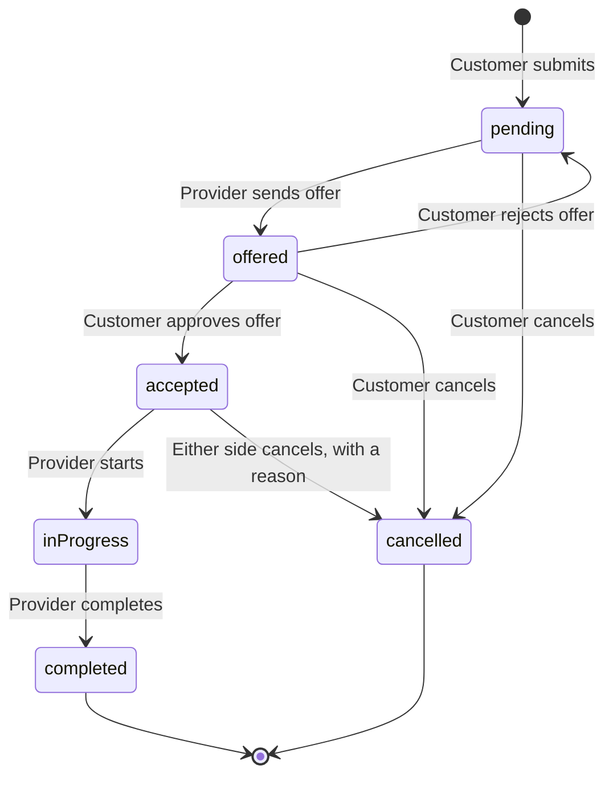

# FixNoww: MVP Product Requirements

| | |
| --- | --- |
| **Version** | 0.2 draft |
| **Date** | 8 November 2026 |
| **Stage** | Working mobile prototype with mock data; backend to be built in a separate workspace |
| **Companion docs** | [Backend guide](BACKEND.md), [Project overview](PROJECT_OVERVIEW.md), [Test status](PRD_TEST_STATUS.md), [Project assessment](PROJECT_ASSESSMENT.md) |

> **How to read this draft.** The "Today" columns reflect the current app, whose data is still in memory. The market scope, business rules and later targets are proposals that haven't been tested with real customers or providers. Section 12 lists the decisions still open.

## 1. Summary

FixNoww is a mobile marketplace for home repairs in Sri Lanka. A household describes a problem and books a time. A local tradesperson offers a price, the customer approves it, and the app tracks the job to completion and review.

**The MVP has one main purpose: learn backend development by building a complete, working product.** It is finished when the mobile app runs end to end on a real Node.js and MySQL backend, across separate phones. Real customers are a possible later stage, not part of the MVP.

## 2. Problem

**Customers** usually find tradespeople through personal contacts. They can struggle to find someone reliable at short notice, may not know a fair price in advance, and have little recourse when a job goes badly.

**Providers** rely on word of mouth, so their work can be uneven, and their reputation doesn't easily reach beyond existing customers.

These are working assumptions. Test them with real people before relying on them for a launch.

## 3. Goals

### MVP goals

The MVP is complete when all of these work on real devices with test data:

| # | Outcome |
| --- | --- |
| 1 | A customer on one phone books a job, and a provider on another phone sees it |
| 2 | The provider sends an offer, and the customer approves or rejects it |
| 3 | The provider starts and completes the job, and both phones show the change |
| 4 | The customer reviews the job, and the provider's rating and earnings update |
| 5 | Users stay logged in, and their data survives closing the app |
| 6 | Two providers claiming one job at the same moment can't both succeed |
| 7 | Users can't see or change data they shouldn't |
| 8 | The API is deployed online and works over mobile data |

### Targets for a later real-user pilot

These don't apply to the MVP. They're starting points to revise if you run a pilot:

| Measure | Proposed target |
| --- | --- |
| Requests that receive an offer within 2 hours | At least 70% |
| Requests that end in a completed job | At least 60% |
| Average rating | 4.3 or higher |
| Jobs disputed | Fewer than 5% |
| Customers who book again within 90 days | At least 25% |

### Non-goals for the MVP

- Real customers, marketing or provider recruitment
- More than three launch trades, or coverage outside the launch area
- Card payments, wallets or automatic payouts
- Chat, maps, or photos of the problem
- Sinhala and Tamil, unless real-user research later shows they're required
- A custom web admin panel; database tools are enough while only test data exists
- Public store releases

## 4. Users

| User | Needs | Main concerns |
| --- | --- | --- |
| **Customer**: a household in the launch area | Fast help, a clear price, someone trustworthy in the home | Overcharging, no-shows, poor work, safety |
| **Provider**: an independent tradesperson | Steady nearby jobs, simple tools, fair treatment | Time-wasting requests, platform fees, unpaid work, data costs |
| **Admin**: the person running FixNoww | See jobs, approve providers, fix problems | Manual work, fraud, handling personal data |

## 5. MVP scope

- **Launch area:** Colombo and nearby suburbs, as test data.
- **Launch trades:** Plumbing, Electrical and AC Repair.
- **Platform:** Android and iOS only. The customer and provider apps have no web or desktop version.
- **Backend:** Node.js, Express and MySQL, built in a separate workspace. See the [backend guide](BACKEND.md).
- **Payment:** cash or direct transfer between customer and provider. The app records the agreed price.
- **Admin:** database tools during the MVP.

## 6. Core flow

1. The customer logs in with their phone number and an OTP.
2. They choose a trade, then enter the address, description and preferred time.
3. Online providers who match the trade and area see the request.
4. A provider sends an offer with a price.
5. The customer approves or rejects it. A rejected request goes back to other providers.
6. The customer can call the provider once the offer is approved.
7. The provider starts the job, then marks it complete.
8. The customer pays the provider directly and leaves a review.

### Booking states

The app already keeps cancelled bookings and enforces this order for its current states. The `offered` step, customer approval, and cancelling after acceptance are not built yet.

Expired requests and disputes are left out of the MVP, and both are planned before real users (section 7).

## 7. Functional requirements

Priority: **P0** is required for the MVP, **P1** before any real users, and **P2** later. Requirement IDs use letter prefixes: `PR` means provider and is not a priority.

### Accounts

| ID | Requirement | Priority | Today |
| --- | --- | --- | --- |
| A1 | Log in with a phone number and OTP, with expiry and rate limits. The code can be printed on the server during development | P0 | Simulated |
| A2 | New users sign up with a name, role and area | P0 | Missing |
| A3 | Users stay logged in, and data survives closing the app | P0 | Missing; pressing Back to leave resets everything |
| A4 | Screens and server actions are restricted by role and ownership | P0 | Missing |
| A5 | Real SMS delivery | P1 | Missing |
| A6 | Providers apply with trade, areas, experience and NIC photo | P1 | Missing |
| A7 | Providers can receive jobs only after admin approval | P1 | Missing |
| A8 | Edit profile and request account deletion | P1 | View only |
| A9 | The debug OTP bypass is removed or confirmed absent before any release | P1 | Debug builds only; Android and iOS releases not yet checked |

### Customer

| ID | Requirement | Priority | Today |
| --- | --- | --- | --- |
| C1 | Choose a service from a category grid | P0 | Built, but shows seven categories |
| C2 | Only the three launch trades are offered | P0 | Missing; the other four can't reach any provider |
| C3 | Booking requires an address, a description, and a future date and time, with clear errors | P0 | Built |
| C4 | View request list, details and status | P0 | Built, one device only |
| C5 | See the provider's name, rating and completed job count on an offer | P0 | Name and rating only, no offer step |
| C6 | Approve or reject an offer | P0 | Missing |
| C7 | Cancel a pending booking after confirming, keeping the record | P0 | Built |
| C8 | Cancel an accepted booking, with a reason | P0 | Missing |
| C9 | Call the assigned provider or support | P0 | Built; opens the dialler |
| C10 | Rate and review a completed job | P0 | Missing |
| C11 | Report a problem | P1 | Missing |
| C12 | Attach up to 3 photos | P2 | Missing |

### Provider

| ID | Requirement | Priority | Today |
| --- | --- | --- | --- |
| PR1 | Go online or offline, which controls whether requests appear | P0 | Built |
| PR2 | See open requests matching their trade and areas, including when the job is scheduled | P0 | Built, using address text matching |
| PR3 | Send an offer with a price greater than zero | P0 | Price checked; takes effect with no customer approval |
| PR4 | Hide a declined request from their own list, leaving it open for others | P0 | Built |
| PR5 | Move a job through started and completed | P0 | Built |
| PR6 | See job history, and earnings calculated from completed jobs | P0 | History built; earnings add up, but start from seed values |
| PR7 | Match on a fixed list of service areas | P0 | Missing |
| PR8 | See their ratings and reviews | P1 | Average only |
| PR9 | Offer an inspection fee plus estimate | P1 | Missing |
| PR10 | Set working hours | P2 | Missing |

### Across the product

| ID | Requirement | Priority | Today |
| --- | --- | --- | --- |
| X1 | Data syncs between devices through a backend | P0 | Local only; repository layer ready |
| X2 | Only one provider can claim a request | P0 | Enforced locally; must also be enforced on the server |
| X3 | Booking status rules are enforced on the server | P0 | Enforced locally |
| X4 | Exact address and phone number are visible only after an offer is approved | P0 | Address visible before acceptance; phone after acceptance |
| X5 | Push notifications for requests, offers, status changes and cancellations | P1 | Missing; bell shows "coming soon" |
| X6 | Audit log of booking changes and admin actions | P1 | Missing |
| X7 | Unanswered offers and requests expire | P1 | Missing |
| X8 | In-app chat | P2 | Placeholder |
| X9 | Map pin and distance-based matching | P2 | Missing |
| X10 | Online payments and payouts | P2 | Missing |

### Admin

Use database tools for the MVP. Build a small web panel before real users.

| ID | Requirement | Priority |
| --- | --- | --- |
| D1 | Staff login with named accounts and two-step verification | P1 |
| D2 | Review, approve, reject and suspend providers, with reasons | P1 |
| D3 | Search bookings and see their history | P1 |
| D4 | Resolve reported problems, and cancel or reassign bookings | P1 |
| D5 | Suspend users and remove reviews | P1 |
| D6 | Dashboard of open, unanswered, completed and disputed jobs | P2 |
| D7 | Manage categories and service areas without an app release | P2 |
| D8 | Commission and payment tracking | P2 |

## 8. Business rules (proposed)

- **Matching:** a request goes to online, active providers with the same trade who cover its area. Areas come from a fixed list, replacing today's address text match.
- **Claiming:** one active offer per request. The first provider to send an offer holds it until the customer responds.
- **Prices:** must be greater than zero. Store money as `DECIMAL`, never a floating-point type.
- **Scheduled time:** must be in the future when the booking is created.
- **Reviews:** only the customer on a completed job can review, once per job.
- **Provider ratings and earnings:** calculated by the server, never entered or sent by the app.
- **Fees:** none during the MVP. See section 12.

## 9. Non-functional requirements

| Area | MVP requirement |
| --- | --- |
| **Security** | Access rules are enforced on the server. No passwords or secret keys in app code. Use only fake data until the security has been reviewed |
| **Performance** | Main screens feel responsive on a mid-range Android phone over mobile data |
| **Reliability** | Backups exist and a restore has been tested |
| **Observability** | Server logs, plus crash reports in test builds if easy to add |
| **Device support** | Works on the current Android test phone (Android 14, 360 × 800), small screens, and at least one iPhone or iOS simulator |

Before real users, also comply with Sri Lanka's Personal Data Protection Act, whose key provisions are scheduled to take effect on 1 January 2027. Move text into translation files if Sinhala or Tamil are needed.

## 10. Risks

| Risk | Impact | Response |
| --- | --- | --- |
| Backend learning takes longer than expected | Slow progress | Follow the stages in the backend guide, finish each before starting the next |
| Scope grows beyond P0 | The project is never finished | Treat section 3's outcomes as the finish line |
| The mobile app and API drift apart | Integration problems | Agree the API from the repository methods listed in the backend guide |
| Real personal data is collected too early | Legal and trust damage | Use fake data until the security review |
| Later: too few providers or customers, or deals moving off the app | The business doesn't work | Test with real people before investing in growth. See the [assessment](PROJECT_ASSESSMENT.md) |
| Later: a safety incident in a customer's home | Serious harm and loss of trust | ID checks, reviews, reporting, suspension and legal terms before real users |

## 11. Release plan

No dates are set, because the pace depends on how backend learning goes.

| Phase | Outcome | Done when |
| --- | --- | --- |
| **1. Mobile cleanup** | Known mobile bugs fixed, repository layer ready | Finished apart from a final phone check; see [test status](PRD_TEST_STATUS.md) |
| **2. Backend foundation** | First API, database, bookings API and login | Stages 1 to 4 of the backend guide pass |
| **3. Connect the app** | The app uses the API instead of mock data | One phone books, and another phone sees it |
| **4. Complete the flow** | Offers, approvals, cancellation, areas, reviews and server rules | MVP outcomes 1 to 7 pass |
| **5. Go online** | API deployed | MVP outcome 8 passes; **the MVP is complete** |
| **6. Optional: real users** | P1 items, web admin, legal review, real-user research | Decide after the MVP |

## 12. Open questions

| Question | Why it matters | Suggested answer until decided |
| --- | --- | --- |
| Will this become a real business after the MVP? | Decides whether phase 6 happens | Decide after the MVP is complete |
| How would FixNoww make money? | Affects the product, trust model and payments | Not needed for the MVP; test commission or a provider subscription first |
| Should the four extra categories be removed or kept as "coming soon"? | C2 needs a decision | Remove them from the grid |
| Should providers quote before or after inspecting? | Many repairs can't be priced remotely | Simple price for the MVP (PR3); inspection fee later (PR9) |
| One offer at a time, or several to compare? | Trades off speed, price and wasted effort | One at a time |
| Is "FixNoww" the final name? | Trademarks and store listings; it also implies instant service while the app is scheduled | Check availability before any store release |
