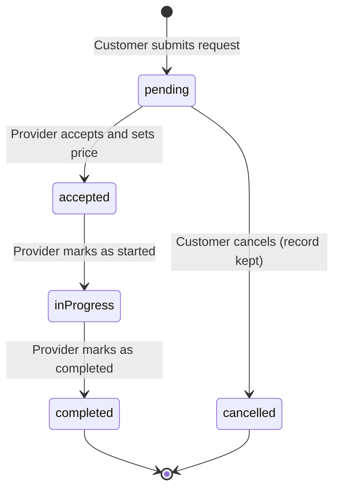

# FixNoww: Project Overview

FixNoww ("Home repairs, sorted.") is a Flutter app that connects people who need home repairs with local tradespeople. Customers post a job, and a provider who matches the trade and area accepts it, sets a price, and moves it through to completion. The seed data and formats target Sri Lanka: `+94` phone numbers, `Rs.` prices, and Colombo-area addresses.

**Current stage: a working mobile prototype.** There is no backend, real authentication, or saved data yet. All data is held in memory, so it resets whenever the app restarts. The backend will be built in a separate workspace and connect through the repository layer described below.

See the [MVP PRD](PRD.md) for requirements, [test status](PRD_TEST_STATUS.md) for current results, and the [backend guide](BACKEND.md) for the server plan.

## Tech stack

| Area | Choice |
| --- | --- |
| Framework | Flutter, Dart SDK `^3.6.0`, Material 3, dark theme only |
| State | `flutter_riverpod` `^2.5.1` (`StateNotifier` and derived `Provider`s) |
| Navigation | `go_router` `^14.0.0` (auth redirect, `StatefulShellRoute` tabs) |
| Data | Repository interfaces with in-memory implementations |
| Phone calls | `url_launcher` |
| Tests | Repository rules and full user flows, run with `flutter test` |

The app targets **Android and iOS only**. Android uses AGP 8.9.1, Gradle 8.11.1 and Kotlin 2.1.0. The bundle ID is still the default `com.example.fixnoww`.

## Getting started

```bash
flutter pub get
flutter run            # add -d <device-id> to pick a phone or simulator
```

Other useful commands are `flutter devices`, `flutter analyze` and `flutter test`.

### Logging in during development

Debug builds have an OTP bypass, because real SMS doesn't exist yet. Any number and any code, including blanks, open a screen where you choose customer or provider. That logs you in as Amaya or Kasun.

To use a specific account, enter its number without `+94`, exactly as shown, with OTP `1234`:

| Name | Phone | Role | Trade | Area | Starts online |
| --- | --- | --- | --- | --- | --- |
| Amaya Silva | `0701111111` | Customer | | Colombo 07 | |
| Saman Perera | `0702222222` | Customer | | Nugegoda | |
| Kasun Perera | `0771234567` | Provider | Plumbing | Colombo | Yes |
| Nimal Fernando | `0777654321` | Provider | Electrical | Colombo | No |
| Ruwan Silva | `0712223344` | Provider | AC Repair | Dehiwala | No |

### Try the full job flow

1. Log in as Amaya, tap **Plumbing**, and complete the form. Include `Colombo` in the address so Kasun's area matches it.
2. Log out and log in as Kasun. The job appears on the **Requests** tab.
3. Accept it and enter a price, then tap **Mark as Started** and **Mark as Completed**.
4. Log back in as Amaya to see the result.

Data survives logging out and using the Home button. **Pressing Back to leave the app resets everything**, so use the Home button while testing.

## Project structure

```text
lib/
├── main.dart              App entry point, ProviderScope, theme
├── router.dart            All routes and the auth redirect
├── models/                AppUser, Booking
├── repositories/          Data interfaces and in-memory demo data
├── providers/             Auth, users and bookings state
├── data/dummy_data.dart   Service categories for the home grid
├── theme/app_colors.dart  Colour constants
├── widgets/               StatusBadge, ServiceChip, price dialog, dialler
└── screens/
    ├── auth/              Phone, OTP, role select
    ├── customer/          Shell, home, create booking, requests, detail, call, profile
    └── provider/          Shell, home, job detail, my jobs, chat, profile
test/
├── booking_repository_test.dart   Booking rules
└── widget_test.dart               Full user flows at phone size
```

## How it works

### Data flow

```text
Screen → Riverpod provider → repository interface → in-memory data
                                                  → API (later)
```

Screens never touch the data source directly. To connect the backend:

1. Write `ApiBookingRepository` and `ApiUserRepository`, implementing the interfaces in [`lib/repositories/`](../lib/repositories/).
2. Return them from `bookingRepositoryProvider` and `userRepositoryProvider`.

Screens shouldn't need changes for this, though loading and network error messages will need adding.

### State

| Provider | Holds |
| --- | --- |
| `userRepositoryProvider`, `bookingRepositoryProvider` | The data source in use |
| `usersProvider` | All users; `toggleOnline`, `addEarnings`, `registerUser` |
| `bookingsProvider` | All bookings; create, accept, decline, start, complete, cancel |
| `authProvider` | The logged-in user; `login`, `logout` |
| `currentUserProvider` | The logged-in user's latest record from `usersProvider` |
| `phoneProvider` | The number entered on the phone screen, passed to the OTP screen |
| `customerBookingsProvider`, `activeBookingsProvider` | A customer's bookings, all or only active |
| `providerIncomingJobsProvider`, `providerMyJobsProvider` | A provider's open matches and assigned jobs |

`authProvider` stores a snapshot, so screens should read `currentUserProvider` to see changes such as the online toggle.

### Navigation

| Path | Screen |
| --- | --- |
| `/` | Phone number |
| `/verify-otp` | OTP |
| `/role-select` | Role select (debug bypass only) |
| `/customer/home`, `my-requests`, `call`, `profile` | Customer tabs |
| `/customer/create-booking`, `booking-detail` | Customer full-screen pages |
| `/provider/home`, `requests`, `chat`, `profile` | Provider tabs: Requests, My Jobs, Chat, Profile |
| `/provider/job-detail` | Provider full-screen page |

The redirect in [`router.dart`](../lib/router.dart#L50) sends logged-out users to `/` and sends logged-in users from the auth screens to their role's home. Full-screen pages receive their data through `state.extra`.

### Booking lifecycle

This is the current app. The [PRD](PRD.md#booking-states) adds a customer approval step.



A provider sees a job as incoming when all of these are true:

- The provider is online and hasn't declined the job.
- Its status is `pending` and it has no provider assigned.
- Its service type exactly matches the provider's trade.
- Its address contains the provider's area, ignoring case.

## Feature status

| Feature | Status |
| --- | --- |
| Create, view and cancel a booking, with validation | Working, in memory |
| Accept with a price, start and complete a job | Working, in memory |
| Online and offline toggle, declining jobs | Working, in memory |
| Earnings | Add up on completion, starting from seed values |
| Call support and call provider | Opens the dialler |
| Phone and OTP login | Simulated: no SMS is sent, and the "OTP" is the account password |
| Ratings | Static seed values |
| Notifications button | Shows "coming soon" |
| Chat | "Coming soon" placeholder |
| Sign-up | Not built: `registerUser` exists but nothing calls it |
| Backend, saved data, customer price approval, reviews, push notifications | Not started |

## Known issues

### Bugs and behaviour gaps

1. **Back wipes data:** pressing Back to leave the app, then reopening it, logs out and resets all data. Saved data from the backend will solve this.
2. **Customers don't approve prices:** a provider's price takes effect immediately. The PRD's offer flow will change this.
3. **No role check on routes:** the redirect only checks that a user is logged in, so a customer who reaches a `/provider/...` path is not blocked.
4. **Missing `extra` causes a crash:** the detail routes cast `state.extra as int`, so opening one directly by URL throws an error.
5. **Extra categories:** Carpentry, Welding, Construction and Other have no seeded provider, so those requests are never matched. The PRD limits the MVP to three trades.
6. **Large amounts display incorrectly:** the price formatter only handles one thousands separator, so 1,000,000 shows as `Rs. 1000,000`.
7. **No cancelling after acceptance:** the customer can call the provider but can't cancel.

### Cleanup

- `status` and `role` are plain strings. Enums would let the compiler catch typos and missed cases.
- Passwords are stored in plain text on the client, which is acceptable only for this mock.
- Profile `_InfoTile`, shell `_BottomNav`, and rupee formatting are each duplicated.
- Colours are defined in both `main.dart` and `AppColors`.
- Seed earnings don't match seed jobs: Nimal has 0 jobs but `Rs. 6,200`.
- `README.md` and the `pubspec.yaml` description are still Flutter template content.

## Suggested next steps

1. Finish the phone recheck in the [test status](PRD_TEST_STATUS.md).
2. Build the backend in its own workspace, following the [backend guide](BACKEND.md).
3. Connect the app through the repository layer.
4. Add the PRD's remaining P0 features: sign-up, offers, reviews and service areas.
